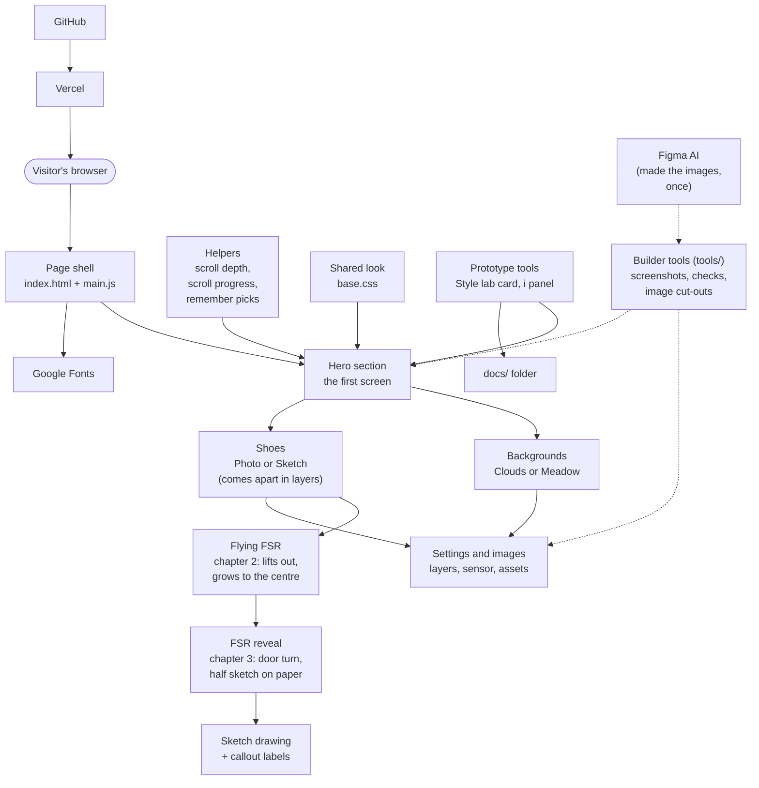

# How the app is built

## The parts

### Page shell
`index.html` is the empty page. `src/main.js` fills it: it adds the hero section, starts the scroll effects, and adds the prototype tools.

### Hero section
The first screen you see (`src/sections/hero.js`). It holds a **background**, the big **"Magic Shoes" title** (`src/components/hero-title.js`) and a **shoe** floating in front of it. When the shoe can come apart, the hero is taller than the screen. Its contents stay pinned while you scroll through it, and that scrolling drives the shoe's motion.

### Backgrounds
Interchangeable looks behind the shoe, listed in `src/backgrounds/index.js`. **Clouds** is the main look: a cream gradient, soft misty clouds and a beige box under the shoe. **Meadow** is the alternative: blurry flowers with a dark tint. Each background also says which text color reads well on top of it.

### Shoes
Interchangeable shoe styles, listed in `src/shoes/index.js`. **Photo** is a realistic beige low-top that just floats. **Sketch** is a marker drawing of a chunky runner that comes apart in layers as you scroll.

### Layers coming apart
`src/components/separating-shoe.js` splits the Sketch drawing in the browser, layer by layer from the bottom up: first the **gray sole**, then the **white foam midsole**. Each cut follows one smooth seam, like a puzzle piece. Each layer has its own settings file (`src/shoes/sketch-sole.js`, `src/shoes/sketch-midsole.js`), its own timing, and a painted top surface (gray tread, white foam tray). The **FSR** (a 3D render of the real force-sensing resistor, `src/assets/fsr-render.png`, placed by `src/components/sensor-drawing.js`, settings in `src/shoes/sketch-sensor.js`) sits in a keyhole-shaped pocket on the white tray. **Part labels** (`src/components/part-labels.js`, wording in `src/shoes/sketch-labels.js`) ride along with their part and fade in as it separates: Outsole, Midsole and FSR. The white midsole's travel is worked out so the gaps between the three pieces are equal.

### Chapter 2: the FSR transition
After the shoe has fanned out and the labels are shown, scrolling on starts **chapter 2**. The FSR lifts out of its pocket, turns upright to face you, and grows to the center of the screen, while the shoe scene scrolls up and away and the next section's background rises in. The page ends with the FSR big and centered (for now).
- **The flying FSR:** `src/components/fsr-transition.js`. It starts exactly where the real FSR lies, using three invisible markers on the FSR's own layer. While it turns to face you, it cross-fades from the angled render to a sharp straight-on render (`fsr-render-front.png`), which does the growing.
- **Its timings:** `src/shoes/fsr-transition.js`.

### Chapter 3: the FSR reveal
Scrolling on after the FSR is big: it **turns like a door** (real 3D, with the pad's thickness showing), then a line **sweeps in from the right**. Behind the line, the FSR becomes a **technical sketch on cream paper**, and **callout labels** fade in one by one.
- **The motion:** `src/components/fsr-reveal.js`. It works on the same flying FSR, which has two identical stacks: the render (with its shadow) and the sketch.
- **The sketch:** `src/components/fsr-sketch.js`, vector lines drawn from the straight-on render's measurements (`front.shape` in `src/shoes/sketch-sensor.js`).
- **The callouts:** `src/components/callouts.js`, reusable for any part.
- **Its settings:** `src/shoes/fsr-reveal.js`.
- **The whole style, as a recipe for other parts:** [electronics-style-guide.md](electronics-style-guide.md).
- **The length of each chapter:** `src/sections/hero-timeline.js` (chapter 1: 1.6 screen-heights, chapter 2: 1.8).

### Settings and images
Plain lists you can edit: where each cloud and flower sits (`src/data/`), where the gray sole is in the drawing, and which paths it can take (`src/shoes/`). The shoe images live in `src/assets/`.

### Scroll depth (parallax)
`src/core/parallax.js` makes background layers move at different speeds as you scroll, which creates depth. Far layers move slower and near layers move faster.

### Scroll progress
`src/core/scroll-progress.js` turns "how far you've scrolled through the hero" into a number from 0 to 1. The shoe uses that number to decide how far apart it is. Scrolling back up runs it backwards.

### Remembers your picks
`src/core/remember-choice.js` stores your last Background, Shoe and Sole picks in your browser, so a reload shows the same thing.

### Style lab card
The frosted-glass "STYLE LAB" card in the top-right corner (`src/components/option-switcher.js`). It lets you flip between options to compare them (Background, Shoe, Sole), with one glass segmented pill per row. Its look is classic frosted "glassmorphism". It's a prototype tool, to be removed once we've decided.

### Info button + panel
The small "i" in the bottom-right corner (`src/components/info-panel.js`). It opens a panel that shows this page and the design-improvements list, read straight from the `docs/` folder, so they never disagree.

### Shared look
`src/styles/base.css` holds the shared colors, fonts, sizes, corners, shadows and motion timings as variables. Change one there and every part that uses it updates.

### Set aside (not shown right now)
The earlier 5-part exploded view (`src/components/exploding-shoe.js`, `src/shoes/sketch-parts.js`, `src/assets/sketch-parts/`). It's kept in case we want pieces of it back. We're rebuilding the fan one part at a time instead.

### Outside services
- **GitHub** stores the code.
- **Vercel** publishes the site whenever new code is pushed to GitHub. The live address is https://magic-shoes.vercel.app/.
- **Google Fonts** provides the Inter and Caveat typefaces.

## AI features
**The app itself has no AI features.** Nothing calls an AI service while someone is using the site, so nothing costs money per visit.

AI was used **once, while building**, to create the shoe images:

| Image | Made with | Where the prompt lives | Cost |
|---|---|---|---|
| Photo shoe (`shoe-photo.png`) | Figma AI image tool (model: gpt-image-2.5-flare), in the Figma file "Magic Shoes – assets", Graft team | [changelog.md](changelog.md), 2026-11-09 entry | 1 Figma AI credit, one time |
| Sketch shoe (`shoe-sketch.png`) | same | same | 1 credit, one time |
| 5-part exploded drawing (`sketch-parts/`, set aside) | same | same | 1 credit, one time |
| FSR render, first version (`fsr-render-v1.png`, not used) | same | [changelog.md](changelog.md), 2026-11-10 "FSR as a 3D render" | 1 credit, one time |
| FSR high-end 3D render (`fsr-render.png`) | same | [changelog.md](changelog.md), 2026-11-10 "FSR as a high-end 3D render" | 1 credit, one time |
| FSR straight-on render for the big view (`fsr-render-front.png`) | same | [changelog.md](changelog.md), 2026-11-10 "the big FSR is now high-definition" | 2 credits, one time |

Backgrounds were removed from the images with Apple's built-in "lift subject" feature on the Mac (free, no internet), using `npm run image:cutout`. The untouched originals, and which Figma frame each came from, are in `design/originals/` (see its README). The steps for a new image are in [tools-and-setup.md](tools-and-setup.md).

### Builder tools
Helpers used only while building, never on the live site: screenshots and zoomed checks (`tools/visual-check/`), motion checks (`tools/motion-debug/`), image cut-out and measuring (`tools/images/`), all sharing one Chrome helper (`tools/shared/chrome.mjs`). See [tools-and-setup.md](tools-and-setup.md).

There are **no secret keys** in this project.
