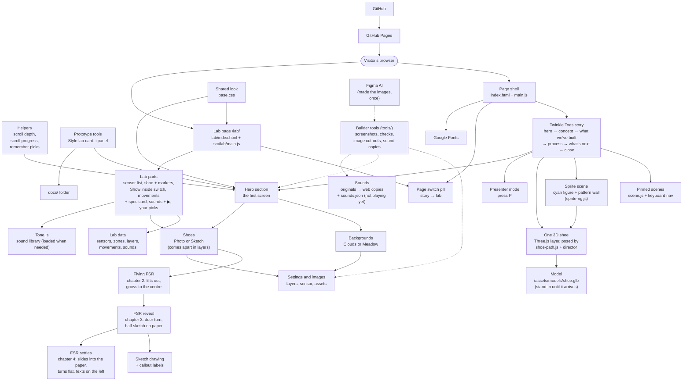

# How the app is built

## The parts

### The Twinkle Toes story (branch `web-presentation-draft`)
The home page is the team's presentation, in this order: **hero → concept → what we've built → process → what's next → close**. Each part is one or more full-screen **scenes** that stay pinned while you scroll.
- **Scenes:** `src/core/scene.js` makes a pinned scene and reports its progress (0 → 1). Each scene has a name (`data-scene`), which the keyboard, the 3D shoe and presenter mode all use.
- **Keyboard:** `src/core/keyboard-nav.js`. Arrow keys, space and Page Up/Down jump to the next stop, like slides.
- **The sections, in order** (listed in `src/main.js`):
  - `tt-hero.js`: the name and one line; the 3D shoe spins below.
  - `concept-movements.js`, on Veruzka's warm dark: "Stories! Movement!" in gradient type, then **one sprite scene**. A cyan pictogram figure (`src/components/sprite-rig.js`, one rig with joint angles, poses based on our bodystorm pictograms) does every movement in place. A wall of round badges behind it shows the same movement at low opacity, pulls back at the start and changes with a ripple from the centre. Rings at the feet show the sound (silent). Under the figure: the movement's name and a random "Yes, and…" offer that rolls in (from `src/data/story-movements.js`). One arrow-key stop per movement (`data-stop-at`).
  - `built-parts.js` → `builtShoeParts`: "Inside each shoe", where the 3D shoe breaks apart and its parts get labels.
  - `hero.js`: **Veruzka's original story, unchanged** (the FSR flies out, is drawn and explains itself), now the close-up inside "What we've built".
  - `built-parts.js` → `builtParts`: the MVP, its photos, and the next build.
  - `process.js`: the timeline, how we tracked movement (bodystorm frames, pose tracking, pictograms in `src/assets/bodystorm/`), Kimiko's critique, the bodystorm grid.
  - `forward.js`, `close.js`.
- **The 3D shoe:** `src/three/shoe-stage.js` draws one shoe in a see-through layer over the page, and `src/three/shoe-director.js` poses it from the scroll, using the path in `src/data/shoe-path.js`. It spins in the hero, shrinks into a **pair on the sprite's feet** (a mirrored copy for the other foot) and rides along with every movement, breaks apart in "Inside each shoe", steps aside for Veruzka's story and the process, then comes back together for the close. It loads `/assets/models/shoe.glb` (`public/assets/models/`); until then a stand-in (the Sketch drawing on a card) follows the same path. The sprite scene tells it where the feet are on screen each frame. It only redraws when something changes.
- **Presenter mode:** `src/components/presenter-notes.js` + `src/data/presenter-notes.js`. Press P for the part, the speaker and the talking points.
- **TODO stickers:** `src/components/todo-tag.js` marks every placeholder.
- **Set aside:** the worlds scene and the earlier seven movement scenes are in `src/_archive/` (see its README).
- **Background for the team and agents:** `cassius-agents/`.

### Page shell
`index.html` is the empty page. `src/main.js` fills it: it adds the sections in order, starts the scroll effects, the 3D shoe and the keyboard, and adds the prototype tools.

### Lab page (`/lab/`)
The prototyping lab, a second page next to the story. `lab/index.html` is its empty page and `src/lab/main.js` fills it. It's being built one small piece at a time; the plan is in [lab-roadmap.md](lab-roadmap.md). Right now it has:
- **The sensor parts list** (`src/lab/sensor-list.js`), on the left: 01 FSR, with 02 Gyro and 03 Capacitive greyed out as "soon".
- **The shoe** (`src/lab/lab-shoe.js`), in the middle. It's the story's coming-apart Sketch shoe (`separating-shoe.js`) with lab-only settings: the shoe opens straight down, and there are no handwritten labels. The FSR lies at the heel in both the story and the lab (`along` in `src/shoes/sketch-sensor.js`). Drawn layers sit on top:
  - **Closed:** picking a sensor draws its marker (a dashed outline of its zone, a red crosshair, and a leader line to a label).
  - **Open:** technical labels ride along with each layer.
- **The movements list** (`src/lab/movement-list.js`), on the right. A movement can be picked only when a placed sensor matches its kind and zone; otherwise it's greyed out with what it needs. The picked movement's **spec card** sits under it: description, rule, and an illustrative chart of what it looks like in the readings (`src/lab/movement-chart.js`).
- **The sounds list** (`src/lab/sound-list.js`), under the movements. Click a row to pick a sound; the ▶ plays it once.
- **The sound engine** (`src/lab/lab-sound.js`): loads **Tone.js** (a free sound library) only when it's about to be needed, builds each sound's instruments once, and plays a hit shaped by strength and sharpness.
- **The "Show inside" switch** (`src/lab/inside-switch.js`), under the shoe. It opens and closes the shoe, and shows the hardware note when the FSR is placed.
- **Your picks** (`src/lab/lab-state.js`): remembers which sensors are on the shoe, whether the shoe is open, and the picked movement and the picked sound, and tells the other parts to redraw. It only stores the choice; each view decides how to animate it, so a 3D shoe can follow the same switch later.
- **The data** (`src/lab/data/`): `sensors.js` (the sensor library, with wiring and safety details) and `zones.js` (where sensors can go, and where each zone is drawn), `layers.js` (the shoe's layers, bottom to top, and which drawing piece shows each one), `movements.js` (what the wearer can do, where, and how to recognise it), and `sounds.js` (each sound, its recipe, and what it takes from a movement). Adding a sensor or a zone means adding an entry here. It uses the same shared look (`base.css`) and the same "i" button as the story. `vite.config.js` tells the build to include both pages.

### Page switch pill
The floating dark pill in the bottom-right corner, just left of the "i": **"Start prototyping →"** on the story and **"← Back to the story"** in the lab. One reusable component, `src/components/page-switch.js`, so both look identical.

### Hero section
The first screen you see (`src/sections/hero.js`). It holds a **background**, the big **"Magic Shoes" title** (`src/components/hero-title.js`) and a **shoe** floating in front of it. When the shoe can come apart, the hero is taller than the screen. Its contents stay pinned while you scroll through it, and that scrolling drives the shoe's motion.

### Backgrounds
Interchangeable looks behind the shoe, listed in `src/backgrounds/index.js`. **Clouds** is the main look: a cream gradient, soft misty clouds and a beige box under the shoe. **Meadow** is the alternative: blurry flowers with a dark tint. Each background also says which text color reads well on top of it.

### Shoes
Interchangeable shoe styles, listed in `src/shoes/index.js`. **Photo** is a realistic beige low-top that just floats. **Sketch** is a marker drawing of a chunky runner that comes apart in layers as you scroll.

### Layers coming apart
`src/components/separating-shoe.js` splits the Sketch drawing in the browser, layer by layer from the bottom up: first the **gray sole**, then the **white foam midsole**. Each cut follows one smooth seam, like a puzzle piece. Each layer has its own settings file (`src/shoes/sketch-sole.js`, `src/shoes/sketch-midsole.js`), its own timing, and a painted top surface (gray tread, white foam tray). The **FSR** (a 3D render of the real force-sensing resistor, `src/assets/fsr-render.png`, placed by `src/components/sensor-drawing.js`, settings in `src/shoes/sketch-sensor.js`) sits in a keyhole-shaped pocket on the white tray. **Part labels** (`src/components/part-labels.js`, wording in `src/shoes/sketch-labels.js`) ride along with their part and fade in as it separates: Outsole, Midsole and FSR. The white midsole's travel is worked out so the gaps between the three pieces are equal.

### Chapter 2: the FSR transition
After the shoe has fanned out and the labels are shown, scrolling on starts **chapter 2**. The FSR lifts out of its pocket, turns upright to face you, and grows to the center of the screen, while the shoe scene scrolls up and away and the next section's background rises in.
- **The flying FSR:** `src/components/fsr-transition.js`. It starts exactly where the real FSR lies, using three invisible markers on the FSR's own layer. While it turns to face you, it cross-fades from the angled render to a sharp straight-on render (`fsr-render-front.png`), which does the growing.
- **Its timings:** `src/shoes/fsr-transition.js`.

### Chapter 3: the FSR reveal
Scrolling on after the FSR is big: it **turns like a door** (real 3D, with the pad's thickness showing), then a line **sweeps in from the right**. Behind the line, the FSR becomes a **technical sketch on cream paper**, and **callout labels** fade in one by one.
- **The motion:** `src/components/fsr-reveal.js`. It works on the same flying FSR, which has two identical stacks: the render (with its shadow) and the sketch.
- **The sketch:** `src/components/fsr-sketch.js`, vector lines drawn from the straight-on render's measurements (`front.shape` in `src/shoes/sketch-sensor.js`).
- **The callouts:** `src/components/callouts.js`, reusable for any part.
- **Its settings:** `src/shoes/fsr-reveal.js`.
- **The whole style, as a recipe for other parts:** [electronics-style-guide.md](electronics-style-guide.md).
- **The length of each chapter:** `src/sections/hero-timeline.js` (chapter 1: 1.6 screen-heights, chapter 2: 1.8, chapter 3: 1.6, chapter 4: 1.6).

### Chapter 4: the FSR settles and explains itself
After the callouts, the line holds still like a **scanner** while the FSR **slides right through it**, so it becomes **fully drawn**. It shrinks a little to fit the cream side and **turns back flat**, and the callouts ride along. Then two short plain-English texts fade in on the left: **"What is an FSR?"** and **"What it does in the shoe"**. The page ends here.
- **The motion:** the same `src/components/fsr-reveal.js` (it takes chapter 3's and chapter 4's progress).
- **The texts:** `src/components/fsr-explainer.js`, reusable for any part. They're added to the page next to the FSR layer, not inside it, so screen readers can read them.
- **Its settings and wording:** `settle` in `src/shoes/fsr-reveal.js`.

### Settings and images
Plain lists you can edit: where each cloud and flower sits (`src/data/`), where the gray sole is in the drawing, and which paths it can take (`src/shoes/`). The shoe images live in `src/assets/`.

### Scroll depth (parallax)
`src/core/parallax.js` makes background layers move at different speeds as you scroll, which creates depth. Far layers move slower and near layers move faster.

### Scroll progress
`src/core/scroll-progress.js` turns "how far you've scrolled through the hero" into a number from 0 to 1. The shoe uses that number to decide how far apart it is. Scrolling back up runs it backwards.

### Remembers your picks
`src/core/remember-choice.js` stores your last Background, Shoe and Sole picks in your browser, so a reload shows the same thing.

### Style lab card
The frosted-glass "STYLE LAB" card in the top-right corner (`src/components/option-switcher.js`). It lets you flip between options to compare them (Background, Shoe, Sole), with one glass segmented pill per row. Its look is classic frosted "glassmorphism". It's a prototype tool, to be removed once we've decided.

### Info button + panel
The small "i" in the bottom-right corner (`src/components/info-panel.js`). It opens a panel that shows this page and the design-improvements list, read straight from the `docs/` folder, so they never disagree.

### Shared look
`src/styles/base.css` holds the shared colors, fonts, sizes, corners, shadows and motion timings as variables. Change one there and every part that uses it updates.

### Set aside (not shown right now)
The earlier 5-part exploded view (`src/components/exploding-shoe.js`, `src/shoes/sketch-parts.js`, `src/assets/sketch-parts/`). It's kept in case we want pieces of it back. We're rebuilding the fan one part at a time instead.

### Sounds (not playing yet)
The untouched originals live in `sounds/`, sorted by category and role. Their small web copies live in `public/sounds/`. The app's list of sounds is `sounds.json`; the app will read sounds from there only. Details and the log: [sound-library.md](sound-library.md).

### Outside services
- **GitHub** stores the code.
- **GitHub Pages** publishes this team copy whenever new code is pushed to `main` (`.github/workflows/pages.yml`). The live address is https://veruzka.github.io/magic-shoes-presentation/. (The original repo publishes on Vercel instead.)
- **Google Fonts** provides the Inter and Caveat typefaces.

## AI features
**Three.js 0.170.0** (free) draws the 3D shoe. **The app itself has no AI features.** Nothing calls an AI service while someone is using the site, so nothing costs money per visit.

AI was used **once, while building**, to create the shoe images:

| Image | Made with | Where the prompt lives | Cost |
|---|---|---|---|
| Photo shoe (`shoe-photo.png`) | Figma AI image tool (model: gpt-image-2.5-flare), in the Figma file "Magic Shoes – assets", Graft team | [changelog.md](changelog.md), 2026-11-09 entry | 1 Figma AI credit, one time |
| Sketch shoe (`shoe-sketch.png`) | same | same | 1 credit, one time |
| 5-part exploded drawing (`sketch-parts/`, set aside) | same | same | 1 credit, one time |
| FSR render, first version (`fsr-render-v1.png`, not used) | same | [changelog.md](changelog.md), 2026-11-10 "FSR as a 3D render" | 1 credit, one time |
| FSR high-end 3D render (`fsr-render.png`) | same | [changelog.md](changelog.md), 2026-11-10 "FSR as a high-end 3D render" | 1 credit, one time |
| FSR straight-on render for the big view (`fsr-render-front.png`) | same | [changelog.md](changelog.md), 2026-11-10 "the big FSR is now high-definition" | 2 credits, one time |

Backgrounds were removed from the images with Apple's built-in "lift subject" feature on the Mac (free, no internet), using `npm run image:cutout`. The untouched originals, and which Figma frame each came from, are in `design/originals/` (see its README). The steps for a new image are in [tools-and-setup.md](tools-and-setup.md).

### Builder tools
Helpers used only while building, never on the live site: screenshots and zoomed checks (`tools/visual-check/`), motion checks (`tools/motion-debug/`), image cut-out and measuring (`tools/images/`), sound web copies (`tools/sounds/`), all sharing one Chrome helper (`tools/shared/chrome.mjs`). See [tools-and-setup.md](tools-and-setup.md).

There are **no secret keys** in this project.
