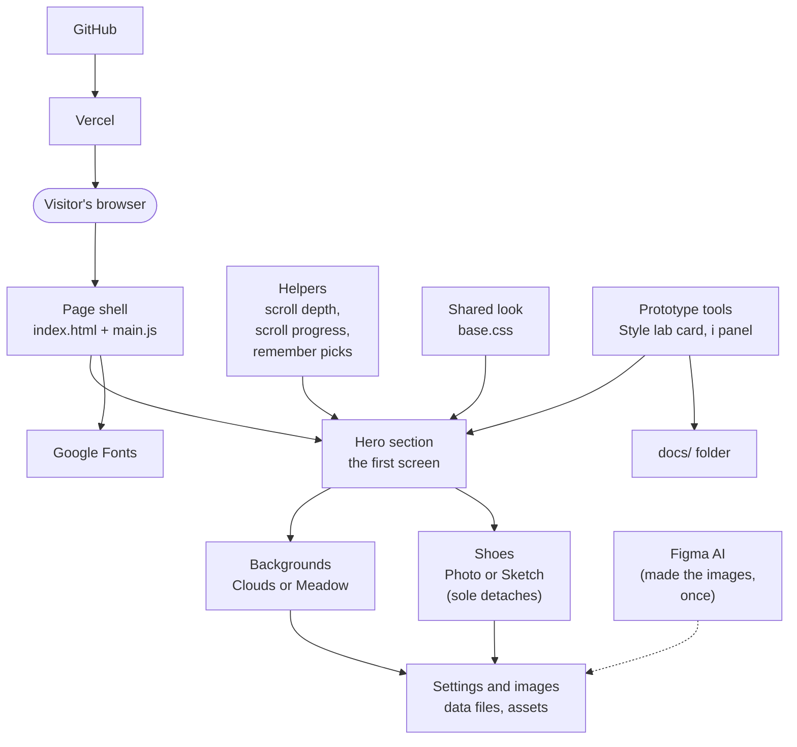

# How the app is built

## The parts

### Page shell
`index.html` is the empty page. `src/main.js` fills it: it adds the hero section, starts the scroll effects, and adds the prototype tools.

### Hero section
The first screen you see (`src/sections/hero.js`). It holds a **background** and a **shoe**. When the shoe can come apart, the hero is taller than the screen. Its contents stay pinned while you scroll through it, and that scrolling drives the shoe's motion.

### Backgrounds
Interchangeable looks behind the shoe, listed in `src/backgrounds/index.js`. **Clouds** is the main look: a cream gradient, soft misty clouds and a beige box under the shoe. **Meadow** is the alternative: blurry flowers with a dark tint. Each background also says which text color reads well on top of it.

### Shoes
Interchangeable shoe styles, listed in `src/shoes/index.js`. **Photo** is a realistic beige low-top that just floats. **Sketch** is a marker drawing of a chunky runner whose gray bottom sole detaches as you scroll.

### Detaching sole
`src/components/separating-shoe.js` splits the Sketch drawing in the browser into the shoe body and the gray sole, cutting along one smooth seam line like a puzzle piece. It then slides the sole away during the first 30% of the scroll. The sole's hidden top surface is painted with the sole's own gray colors.

### Settings and images
Plain lists you can edit: where each cloud and flower sits (`src/data/`), where the gray sole is in the drawing, and which paths it can take (`src/shoes/`). The shoe images live in `src/assets/`.

### Scroll depth (parallax)
`src/core/parallax.js` makes background layers move at different speeds as you scroll, which creates depth. Far layers move slower and near layers move faster.

### Scroll progress
`src/core/scroll-progress.js` turns "how far you've scrolled through the hero" into a number from 0 to 1. The shoe uses that number to decide how far apart it is. Scrolling back up runs it backwards.

### Remembers your picks
`src/core/remember-choice.js` stores your last Background, Shoe and Sole picks in your browser, so a reload shows the same thing.

### Style lab card
The frosted-glass "STYLE LAB" card in the top-right corner (`src/components/option-switcher.js`). It lets you flip between options to compare them (Background, Shoe, Sole, Glass), with one segmented pill per row. The Glass row switches the card between Dimpled lens glass (`src/components/glass-styles.js`) and Frosted glass. It's a prototype tool, to be removed once we've decided.

### Info button + panel
The small "i" in the bottom-right corner (`src/components/info-panel.js`). It opens a panel that shows this page and the design-improvements list, read straight from the `docs/` folder, so they never disagree.

### Shared look
`src/styles/base.css` holds the shared colors, fonts, sizes, corners, shadows and motion timings as variables. Change one there and every part that uses it updates.

### Set aside (not shown right now)
The earlier 5-part exploded view (`src/components/exploding-shoe.js`, `src/shoes/sketch-parts.js`, `src/assets/sketch-parts/`). It's kept in case we want pieces of it back. We're rebuilding the fan one part at a time instead.

### Outside services
- **GitHub** stores the code.
- **Vercel** publishes the site whenever new code is pushed to GitHub. The live address is https://magic-shoes.vercel.app/.
- **Google Fonts** provides the Inter and Caveat typefaces.

## AI features
**The app itself has no AI features.** Nothing calls an AI service while someone is using the site, so nothing costs money per visit.

AI was used **once, while building**, to create the shoe images:

| Image | Made with | Where the prompt lives | Cost |
|---|---|---|---|
| Photo shoe (`shoe-photo.png`) | Figma AI image tool (model: gpt-image-2.5-flare), in the Figma file "Magic Shoes – assets", Graft team | [changelog.md](changelog.md), 2026-11-09 entry | 1 Figma AI credit, one time |
| Sketch shoe (`shoe-sketch.png`) | same | same | 1 credit, one time |
| 5-part exploded drawing (`sketch-parts/`, set aside) | same | same | 1 credit, one time |

Backgrounds were removed from the images with Apple's built-in "lift subject" feature on the Mac (free, no internet).

There are **no secret keys** in this project.
